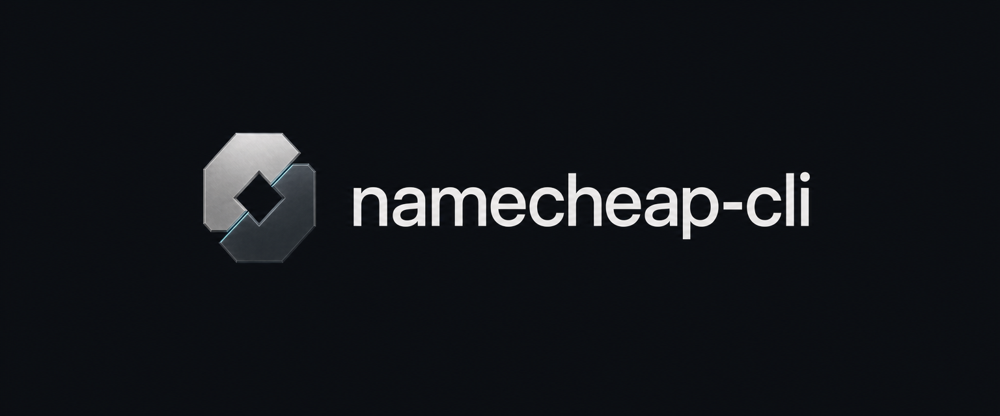

<p align="center">
  
</p>

<h1 align="center">Namecheap CLI</h1>

<p align="center">
  <strong>Guarded Namecheap DNS automation for AI agents, CI pipelines, and terminal workflows.</strong>
</p>

<p align="center">
  <a href="https://github.com/R-Varun/namecheap-cli/actions/workflows/ci.yml"></a>
  <a href="https://r-varun.github.io/namecheap-cli/"></a>
  <a href="https://www.python.org/"></a>
  <a href="pyproject.toml"></a>
  <a href="skills/namecheap-dns/SKILL.md"></a>
  <a href="LICENSE"></a>
</p>

---

Namecheap's `domains.dns.setHosts` XML endpoint **overwrites an entire zone in a single call**—one missing field in an ad-hoc script can wipe existing `MX`, `TXT`, or `CNAME` records.

`namecheap-cli` wraps Namecheap BasicDNS and nameserver management in a zero-dependency CLI engineered for autonomous AI agents and deterministic scripts:

- **Dry-run by default** — Every mutation (`dns set`, `dns add`, `dns remove`, `dns apply`, `ns set`, `restore`) computes a structured diff and SHA-256 `state_hash` without touching live DNS until `--yes --if-match <HASH>` is supplied.
- **Versioned JSON contract** — Every command prints one `schema_version: 1` JSON envelope on `stdout` (including validation errors and exit codes), with `--human` available for terse terminal output.
- **Guarded whole-zone writes** — Holds a local per-account/domain lock, writes a `0600` backup and recovery journal before calling `setHosts`, preserves mail-routing modes (`MX`, `MXE`, `FWD`, `OX`), and verifies every record, TTL, and MX preference afterward.
- **Live public DNS verification** — `namecheap dns check` queries Cloudflare DNS-over-HTTPS to confirm public resolvers match Namecheap's stored zone.

## Why `namecheap-cli`?

| Capability | `namecheap-cli` | Ad-hoc XML scripts | Always-on MCP servers |
|---|---|---|---|
| **Whole-zone clobber protection** | Diff preview + `--if-match` SHA-256 + post-write verify | Easy to drop `MX`/`TXT` records | Rarely optimistic-locked |
| **Pre-write backup & rollback** | Automatic `0600` backup + `namecheap restore` | Manual | Manual |
| **Idle context window cost** | **0 tokens** until needed (`namecheap schema`) | Requires reading custom script | Tool definitions loaded every turn |
| **Live propagation verification** | Built-in `namecheap dns check` (Cloudflare DoH) | Separate `dig` / `nslookup` glue | Separate tooling |
| **Runtime footprint** | **Python 3.11+ stdlib only** (0 dependencies) | `requests`, `lxml`, `python-dotenv` | Persistent Node/Python server |

## Install

Requires **Python 3.11+** with zero third-party runtime dependencies.

```sh
# Install globally in an isolated environment with uv
uv tool install 'git+https://github.com/R-Varun/namecheap-cli'

# Or with pipx
pipx install 'git+https://github.com/R-Varun/namecheap-cli'
```

Want to inspect the full command and schema catalogue first with **zero installation and no API credentials**?

```sh
uvx --from 'git+https://github.com/R-Varun/namecheap-cli' namecheap schema
```

## Quickstart

### 1. Configure allowlist & credentials

Enable [Namecheap API access](https://www.namecheap.com/support/api/intro/) and whitelist your machine's public IPv4 address in your Namecheap account.

```sh
namecheap config init --domain example.com
namecheap auth setup --username YOUR_NAMECHEAP_USERNAME
namecheap doctor
```

- `auth setup` reads your API key from a hidden terminal prompt and saves it to a `0600` local credential file.
- For agents and CI, pass `NAMECHEAP_API_USER` and `NAMECHEAP_API_KEY` via your secret store or environment instead—never pass keys on the command line or inside prompts.
- Only allowlisted domains can be read or modified by domain-targeted commands. Manage scope with `namecheap config allow example.net` and `namecheap config disallow example.net`.

### 2. Preview, apply, and verify live DNS

```sh
# 1. Inspect current zone
namecheap dns list example.com

# 2. Preview a change (read-only dry run; returns diff + state_hash)
namecheap dns set example.com @ A 203.0.113.10

# 3. Apply using the 64-character SHA-256 state_hash from step 2
namecheap dns set example.com @ A 203.0.113.10 --yes --if-match <STATE_HASH>

# 4. Verify live public DNS propagation over HTTPS
namecheap dns check example.com --host @ --type A
```

### Common operations

```sh
# Records: set replaces conflicting/same-type records; add appends multi-value records
namecheap dns set example.com www CNAME @
namecheap dns add example.com @ TXT 'v=spf1 include:_spf.example.net ~all'
namecheap dns add example.com @ MX mail.example.com --mxpref 10 --email-type MX
namecheap dns remove example.com staging A --value 203.0.113.20

# Atomic multi-record zone apply from a file or stdin (-)
namecheap dns apply example.com zone.json
jq '.data.zone | .hosts += [{"name":"api","type":"A","address":"203.0.113.30","ttl":1800}]' current.json \
  | namecheap dns apply example.com -

# Nameserver delegation & availability checks
namecheap ns list example.com
namecheap ns set example.com --custom ns1.example.net ns2.example.net
namecheap domains list
namecheap domains check example.org example.net
```

## Built for AI Agents

No MCP server or custom XML wrapper needed—agents invoke `namecheap` directly over `subprocess` and parse deterministic JSON on `stdout`.

### Install the bundled Agent Skill (`SKILL.md`)

Copy [`skills/namecheap-dns`](skills/namecheap-dns/SKILL.md) into your agent's skills directory (Claude Code, Codex, Cursor, OpenClaw):

```sh
# Claude Code
mkdir -p ~/.claude/skills && cp -R skills/namecheap-dns ~/.claude/skills/

# Codex / cross-agent ~/.agents/skills
mkdir -p ~/.agents/skills && cp -R skills/namecheap-dns ~/.agents/skills/
```

### Or add a 5-line `CLAUDE.md` / `AGENTS.md` rule

```markdown
## Namecheap DNS (`namecheap`)
- Run `namecheap schema` to inspect commands, arguments, zone schema, and error codes.
- Always preview mutations without `--yes` first, inspect `data.diff` and `warnings`, then apply with `--yes --if-match <data.state_hash>`.
- Pass arguments as an argv array (never shell-interpolate TXT values) or pipe zone JSON to `namecheap dns apply <domain> -`.
- Confirm public resolver propagation with `namecheap dns check <domain>` when needed.
```

Machine-readable discovery endpoints are also hosted at [`schema.json`](https://r-varun.github.io/namecheap-cli/schema.json) and [`llms.txt`](https://r-varun.github.io/namecheap-cli/llms.txt).

## Write Safety & Recovery

Every confirmed write executes a strict transaction:

1. Acquires a local lock scoped to `(account, environment, domain)`.
2. Reads the live zone and verifies `--if-match` matches the canonical SHA-256 `state_hash`.
3. Writes a `0600` JSON backup and `"prepared"` recovery journal entry.
4. Re-reads immediately before submission to catch concurrent external changes.
5. Submits `setHosts` / `setCustom` / `setDefault` once (never auto-retries writes).
6. Reads back and verifies every host record, TTL, MX preference, and email mode.

If a write cannot be verified (exit code `4`, `write_unverified`), inspect `error.details.outcome` (`"rejected"` vs `"unknown"`) and preview a rollback from the automatic backup:

```sh
namecheap restore /path/from/result/backup.json
namecheap restore /path/from/result/backup.json --yes --if-match <STATE_HASH>
```

**Scope boundaries:** `namecheap-cli` manages BasicDNS host records (`A`, `AAAA`, `ALIAS`, `CNAME`, `MX`, `MXE`, `NS`, `TXT`, `URL`, `URL301`, `FRAME`), nameserver delegation, account domain listing, availability checks, and public DoH verification. It never purchases, renews, or transfers domains, and it blocks writes rather than clobbering unsupported dashboard settings (such as DDNS or inactive host rows).

## Troubleshooting

| Error Code | Exit | Cause & Resolution |
|---|---|---|
| `credentials_missing` | `66` | Run `namecheap auth setup --username USER` or set `NAMECHEAP_API_USER` + `NAMECHEAP_API_KEY`. |
| `ip_detection_failed` | `1` | Set `NAMECHEAP_CLIENT_IP` to your Namecheap-whitelisted public IPv4 address. |
| `out_of_scope` | `3` | Domain is not in your local allowlist. Run `namecheap config allow <domain>`. |
| `stale_state` | `3` | Zone changed after your preview. Re-run the dry-run preview and use the new `state_hash`. |
| `external_dns` | `3` | Domain uses custom third-party nameservers (`ns list`) instead of Namecheap BasicDNS. |
| `email_mode_unknown` | `3` | Pass an explicit `--email-type` (`MX`, `MXE`, `FWD`, `OX`) when altering mail routing. |
| `write_unverified` | `4` | Check `namecheap dns list <domain>` and `error.details.recovery.backup_file` before retrying. |

## Documentation

- [Agent Integration Guide](docs/agents.md) — Subprocess patterns, batch stdin edits, and error handling
- [Command Contract](docs/cli.md) — All 18 commands, JSON envelope structure, and exit codes
- [Write Safety Model](docs/safety.md) — Locking, whole-zone hazards, email modes, and recovery journals
- [Configuration & Sandbox](docs/configuration.md) — Paths, environment variables, `--sandbox` isolation, and rate spacing
- [Installable Agent Skill](skills/namecheap-dns/SKILL.md) — Ready-to-drop `SKILL.md` for coding agents

## Development

```sh
git clone https://github.com/R-Varun/namecheap-cli.git
cd namecheap-cli
uv sync --extra dev
uv run pytest --cov=namecheap_cli --cov-report=term-missing
uv run ruff check .
uv run ruff format --check .
uv build && uv run python scripts/check_distribution.py
```

CI validates Python 3.11–3.14 on Linux plus macOS and Windows, verifies wheel and sdist metadata in clean environments, and builds the static documentation site. See [CONTRIBUTING.md](CONTRIBUTING.md), [SECURITY.md](SECURITY.md), [CHANGELOG.md](CHANGELOG.md), and [LICENSE](LICENSE).

---

<sub>Unofficial open-source project. Not affiliated with, endorsed by, or sponsored by Namecheap, Inc.</sub>
