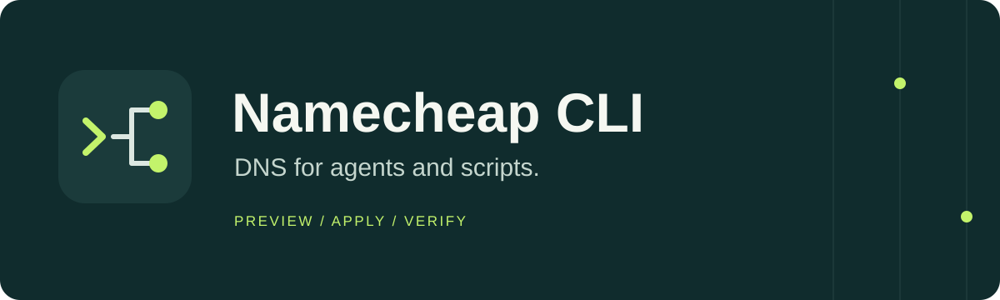

<p align="center">
  
</p>

# Namecheap CLI: DNS automation for AI agents and scripts

[](https://github.com/R-Varun/namecheap-cli/actions/workflows/ci.yml)
[](https://www.python.org/)
[](LICENSE)

Manage Namecheap DNS records and nameservers from your terminal or an AI agent.
No one-off API scripts. No guessing whether a command changed something.

The CLI returns JSON, previews every DNS change, and saves a backup before it
writes. An agent can inspect a domain, prepare its records, apply an authorized
change, and check the result using the same small set of commands.

**Unofficial. No affiliation with Namecheap.** This first release is a beta.
It has automated offline tests, including a local HTTP API and multiple CLI
processes. Authenticated sandbox and live writes have not been validated yet.

## What it does

- Read and edit BasicDNS host records: A, AAAA, ALIAS, CNAME, MX, MXE, NS, TXT,
  and URL redirects.
- Read and change nameservers.
- List account domains and check domain availability.
- Return structured errors, diffs, state hashes, backups, and recovery paths.
- Keep production and sandbox credentials and state separate.

It does not register, renew, buy, or transfer domains. DNSSEC, SRV, CAA, and
provider-managed DNS settings are outside the first release. A zone containing
unsupported records or settings is readable, but record writes stop rather
than risk losing data.

## Install

Requires Python 3.11 or newer. There are no runtime dependencies.

With [uv](https://docs.astral.sh/uv/):

```sh
uv tool install --python 3.12 'git+https://github.com/R-Varun/namecheap-cli@v0.1.0'
namecheap --help
```

Or use `pipx install 'git+https://github.com/R-Varun/namecheap-cli@v0.1.0'`
with a supported Python. The package is called `namecheap-agent-cli`; the
command is `namecheap`. It is installed from GitHub, not PyPI.

## Set it up

Enable [Namecheap API access](https://www.namecheap.com/support/api/intro/) and
whitelist your machine's public IPv4 in your Namecheap account. Namecheap sets
its own eligibility rules for API access.

```sh
namecheap config init --domain example.com
namecheap auth setup --username YOUR_NAMECHEAP_USERNAME
namecheap doctor
```

`auth setup` asks for the API key at a hidden terminal prompt and stores it in
a private local file. Agents can receive `NAMECHEAP_API_USER` and
`NAMECHEAP_API_KEY` through their secret manager or environment instead.
Do not put keys in prompts or command-line arguments.

Only listed domains can be read or changed through domain-specific commands.
To add another domain you are authorized to manage:

```sh
namecheap config allow example.net
```

## Preview, then apply

Read the current records:

```sh
namecheap dns list example.com
```

Preview an edit:

```sh
namecheap dns set example.com @ A 203.0.113.10
```

Read `data.diff`, `warnings`, and `data.state_hash` in the result. Then apply
that edit using the returned state hash:

```sh
namecheap dns set example.com @ A 203.0.113.10 --yes --if-match STATE_HASH
```

`STATE_HASH` above is a placeholder for the full hash from your preview. If the
domain changed in the meantime, the command refuses the stale write.

`set` replaces all records of the same type at that host, plus records that
conflict with the new one. Use `add` when you want another A, MX, or TXT value.
Adding an identical record and removing an absent record are no-ops.

More examples:

```sh
namecheap dns set example.com www CNAME @
namecheap dns add example.com @ TXT 'site-verification=example'
namecheap dns remove example.com old A --value 203.0.113.20
namecheap ns set example.com --custom ns1.example.net ns2.example.net
namecheap domains check example.org example.net
```

Every edit shown above is a dry run. Confirmed writes need both `--yes` and
`--if-match`. Use `--human` for a short terminal view.

## Built for agents

```sh
namecheap schema
```

This returns command arguments, output schemas, the zone-file schema, and exit
codes. Normal commands print exactly one JSON document, including failures.
They do not prompt for confirmation. The output envelope is versioned:

```json
{
  "schema_version": 1,
  "ok": false,
  "command": "dns set",
  "error": {
    "code": "stale_state",
    "message": "The domain changed since the preview. Preview again.",
    "details": {},
    "retryable": false
  }
}
```

Start with the [agent guide](docs/agents.md) and [command reference](docs/cli.md).
For several record changes, export `data.zone` from `dns list`, edit that JSON,
and use `dns apply example.com zone.json`. That applies one complete record set.

## What protects a write

Namecheap's `setHosts` replaces the whole zone. This CLI holds a local
account/domain lock, checks the preview's state hash, saves a private backup
and journal, reads again for outside edits, submits once, and verifies the
records, TTLs, MX preferences, and email mode.

If a submitted write cannot be verified, exit code 4 includes recovery paths.
Inspect the current state before retrying. To preview a restoration:

```sh
namecheap restore /path/from/result/backup.json
```

Restoration is another guarded change. A nameserver backup restores delegation
only. Check records at the DNS provider separately.

The lock coordinates processes sharing the same local state directory. It
cannot lock the Namecheap dashboard or another machine. The last read narrows
that race; it cannot make the provider's write atomic. Avoid other DNS writers
while a change is running.

The CLI preserves supported email modes. It will not guess a missing mode or
assume that omitting a parameter turns email off. Intentional mail changes
need `--email-type MX|MXE|FWD|OX`; adding custom MX records also needs an explicit
mode change. Read [the safety notes](docs/safety.md) before using production.

## Configuration and sandbox

Default files live under `~/.config/namecheap-cli/` and
`~/.local/state/namecheap-cli/` on macOS/Linux, or AppData on Windows.
See [configuration](docs/configuration.md) for paths and environment variables.

Use `--sandbox` with separate `NAMECHEAP_SANDBOX_API_USER` and
`NAMECHEAP_SANDBOX_API_KEY` credentials. Production environment variables are
never used as fallback sandbox credentials.

## Development

```sh
git clone https://github.com/R-Varun/namecheap-cli.git
cd namecheap-cli
uv sync --extra dev
uv run pytest --cov=namecheap_cli --cov-report=term-missing
uv run ruff check .
uv run ruff format --check .
uv build
```

Tests use synthetic domains and credentials. CI checks Python 3.11–3.14 on
Linux, plus macOS and Windows. See [contributing](CONTRIBUTING.md),
[security](SECURITY.md), and the [MIT license](LICENSE).
